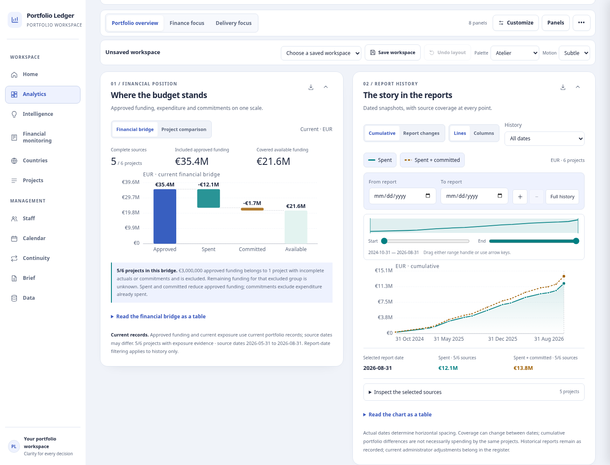
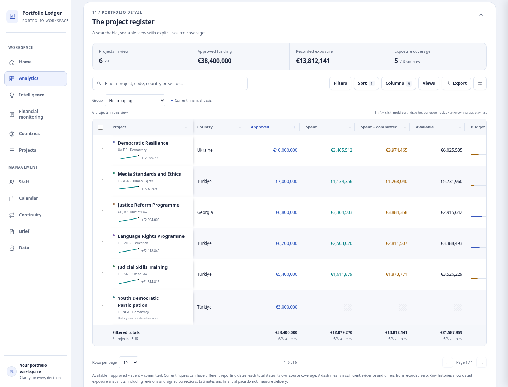

# Portfolio Ledger

An offline portfolio intelligence studio with connected financial charts,
a customizable analytical register, source evidence, project schedules and
saved working contexts. The supplied
ledger's report, forecast, contract, document-import and financial-evidence
engine is retained.


## Download and run

Download **index.html** using GitHub's **Download raw file** button, or download
this repository as a ZIP. The generated HTML contains the application, styles,
sample portfolio, graphics and embedded PDF readers. Running it requires no
package installation or build step.

For hosted development, run from this directory:

```sh
python3 -m http.server 8000 --bind 127.0.0.1 --directory .
```

Use a modern browser with JavaScript, IndexedDB and SVG support. The optional
**sw.js** adds an offline document cache when served from a secure context or
loopback host; keep it beside index.html for hosted offline use.

Records and imported documents live in browser storage. Use **Data → Export
backup** to move a portfolio between browser profiles or hosting origins. The
initial six-project portfolio is explicitly labelled as sample data.

## Make the workspace yours

**Home** and **Analytics** share three independently saved profiles:
Portfolio overview, Finance focus and Delivery focus. **Panels** chooses from
12 panels. **Customize** reveals drag handles, Earlier / Later controls,
width selection and pinning. Handles also support **Alt + ↑ / ↓**; phones
support vertical touch dragging and edge scrolling.

Collapse, hide or resize panels without editing portfolio records. Layout
settings use the separate `ledger.workspace.v2` storage key. The tools menu
exports/imports a layout or restores the active profile's default layout.
Portfolio backup remains a separate operation.

The studio includes:

- A shared country/project selection across financial figures, charts, source
  coverage, register and schedule. Report-date windows affect historical views;
  current budgets and actuals retain their current financial basis.
- A source-aware budget waterfall and a project comparison mode. Missing sources,
  overspend and signed financial corrections are explicit.
- Dated cumulative history or matched report changes, line/column modes, native
  date-range navigation, zoom, selectable chart points and source detail.
  Opening values and newly covered projects never become invented period spend.
- Clickable country/sector composition and project pace comparisons that connect
  back to the shared selection. Financial pace does not measure delivery.
- A register with per-column filters, up to four sort priorities, draggable and
  resizable columns, frozen identity/additional columns, nested grouping with
  source-counted subtotals, saved views, source details and genuine history
  sparklines. Missing values remain distinct from recorded zero.
- All filtered or selected records exported as safe CSV, a real three-sheet XLSX
  workbook with typed numbers/dates, or a full register printout independent of
  pagination. Excel includes provenance and analysis context.
- A schedule with quarter/month/week scales, sticky project labels, planned-date
  windows, preparation/execution segments and recorded milestone source sheets.
- A people studio with base distribution, project staffing/FTE coverage, missing
  detail queues, live search, sortable table/cards, source evidence, full CSV and
  printing. Existing contract editing remains available; unknown FTE stays unknown.
- Named workspaces saving selection, panels, chart/table preferences, palette and
  forecast scenario; layout undo complements keyboard, mouse and touch arranging.
- Atelier, Executive and Contrast palettes, a consistent financial color system,
  light/dark themes, visible selection/focus effects and an effects-off preference.
- Framed SVG/1800px PNG chart exports with scope, dates and source descriptions,
  and a printable decision brief based on the current selected evidence.

<details>
<summary>Charts, register and people previews</summary>






</details>

<details>
<summary>Phone preview</summary>


</details>

## Maintain the code

The distributable remains a single HTML file, while editable source is split
into focused source modules:

| File                          | Purpose                                                                 |
| ----------------------------- | ----------------------------------------------------------------------- |
| `src/ledger-base.html`        | Retained ledger engine, shared screens and embedded parsers             |
| `src/workspace.js`            | Workspace integration, panel layout and canonical register values       |
| `src/studio-shell.js`         | Shared analysis scope, named workspaces, layout undo and decision brief |
| `src/chart-studio.js`         | Source-aware charts, dated navigation and cross-filtering               |
| `src/register-studio.js`      | Advanced table interactions and saved register views                    |
| `src/register-export.js`      | Offline native XLSX and complete register print export                  |
| `src/schedule-studio.js`      | Source-backed project/activity schedule and milestone detail            |
| `src/staff-studio.js`         | Document-led people analysis, register and evidence follow-up           |
| `src/*.css`, `src/studio.css` | Feature styles and the shared visual design system                      |
| `scripts/build.py`            | Generates the distributable `index.html` using Python only              |
| `sw.js`                       | Optional scoped offline document cache                                  |

After editing source, regenerate the distributable with Python's standard
library:

```sh
python3 scripts/build.py
```

Do not hand-edit generated index.html. The builder checks its integration
points so engine changes cannot silently detach the workspace. No third-party
build tooling is required. Existing portfolio storage keys and embedded PDF
readers are preserved.

## Validate

The cloud image provides Node.js, Playwright and `/usr/bin/chromium`:

```sh
node --check src/workspace.js
python3 scripts/build.py
node tests/smoke.cjs
node tests/workspace.cjs
node tests/studio.cjs
node tests/staff.cjs
```

The browser suites start and stop their own Python servers, use isolated
profiles, and never touch a user's portfolio. Smoke tests cover 26 screens
at desktop and phone widths, filters, map/keyboard navigation, themes,
project validation and creation, undo/redo, backup round-tripping, actual
offline reload, self-contained rendering and print visibility.

Workspace tests cover mouse dragging, real Chromium touch input, keyboard
movement, persistent layouts, profile isolation, layout import/export/reset,
source-preserving scenarios, five viewport widths, SVG/PNG exports, register
interactions and controlled financial fixtures. Fixtures check cumulative
snapshots, known zero versus missing evidence, signed corrections, overspend,
CSV escaping and totals across multiple pages.

Studio tests check connected scope and date invariance, matched report changes,
refunds and changing coverage, chart navigation, layout undo and named contexts,
real palette/effects changes, numeric filters and multi-sort, column drag/resize,
nested subtotals and saved views, native workbook ZIP/XML data, complete printing,
source-backed milestones and narrow mobile layouts. All fixtures are disposable.

People tests cover a disposable 31-assignment source fixture, evidenced zero versus
unknown FTE, source payroll context, separate manual records, original contract
editing, connected people filters, safe full CSV, complete printing and mobile cards.

Set `CHROMIUM_PATH` for another browser installation. Set `LEDGER_TEST_PORT`
`LEDGER_WORKSPACE_TEST_PORT`, `LEDGER_STUDIO_TEST_PORT` or
`LEDGER_STAFF_TEST_PORT` if ports 8765/8766/8767/8769 are occupied. Outside the
cloud image, provide Playwright and a Chromium installation yourself.

These checks exercise the retained workflows and new presentation layer;
they do not exhaustively validate every original document parser or financial
calculation.
