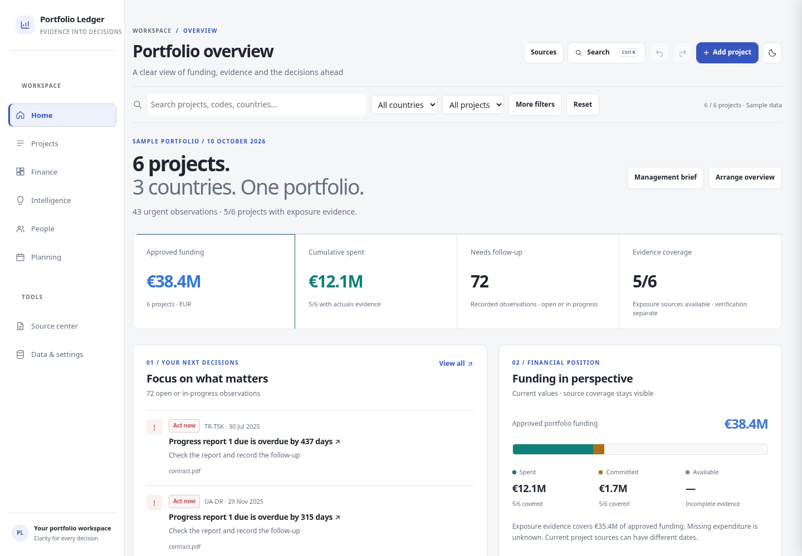
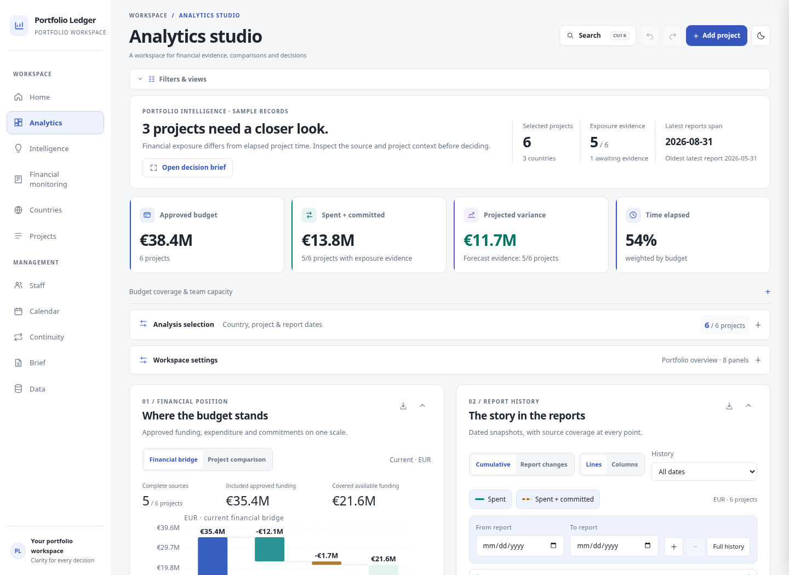
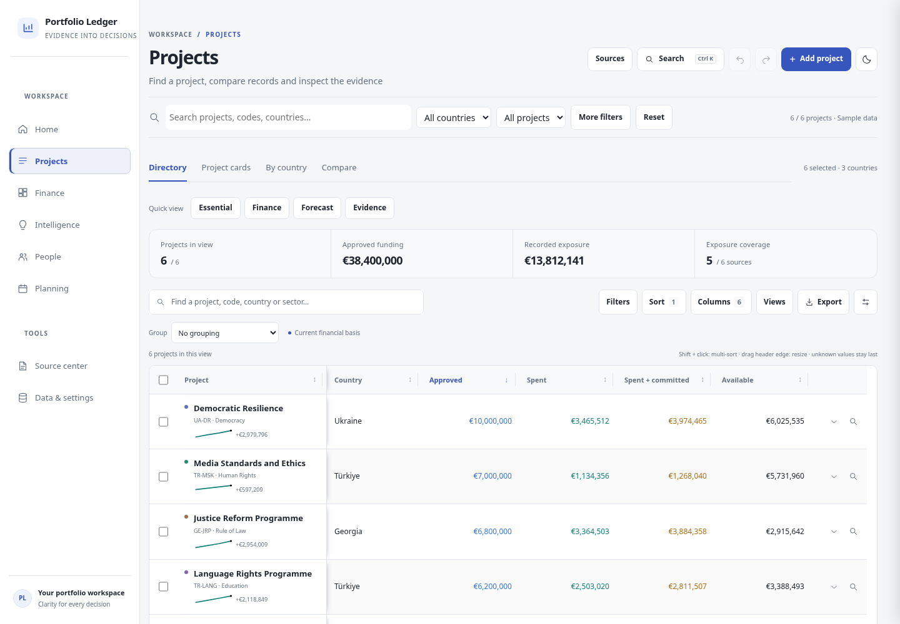
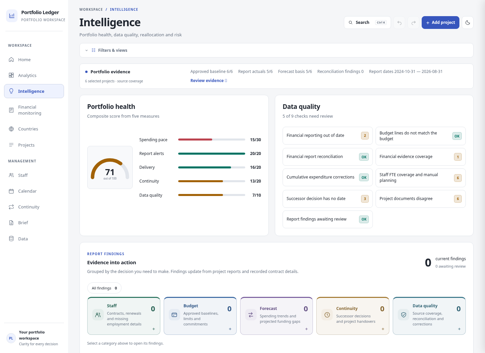
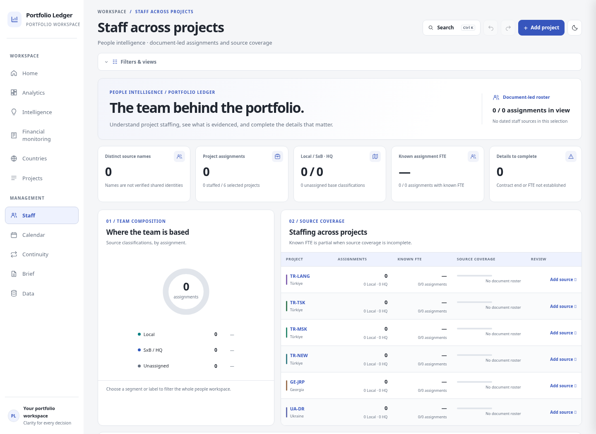
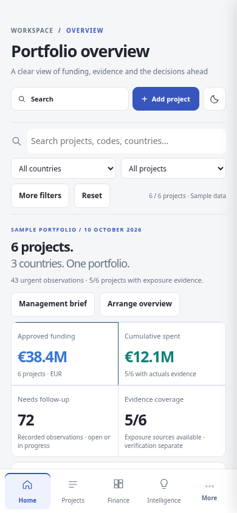

# Portfolio Ledger

**Uploaded Ledger 40, with its original structure preserved:** use
[portfolio-ledger-professional.html](portfolio-ledger-professional.html) or the
[dedicated ZIP](downloads/portfolio-ledger-professional.zip). This separate variant
adds optional styling, performance and table/chart tools to the exact uploaded
file. See [its architecture and validation](docs/PRESERVED_STRUCTURE.md).
The `index.html` described in the legacy section below is the earlier six-workspace version.

## Download and run the current Professional version

Download [portfolio-ledger-professional.zip](downloads/portfolio-ledger-professional.zip),
extract it, and open **portfolio-ledger-professional.html** in a modern browser.
You can also download that HTML using GitHub's **Download raw file** button.
This is the structure-preserving version based on the latest uploaded Ledger 40.
It requires no installation, backend, or external assets. Browser records belong
to the current profile/origin; use the original Data backup tools when moving them.

```sh
python3 scripts/build-professional.py
node tests/professional.cjs
node tests/refinements.cjs
```

The current update adds compact Calendar navigation, a full-width Brief with
source evidence, expandable Data groups, bounded searchable Logframe indicators,
and source-backed budget unit/name columns. See the [five-area review record](docs/REFINEMENT_REVIEW.md).

The [seven-role review protocol](docs/REVIEW_PROTOCOL.md) defines independent
review, correction and re-approval. Actual findings and verdicts are recorded in
[the review log](docs/REVIEW_LOG.md).

## Earlier six-workspace version — index.html

A self-contained, offline portfolio workspace. Six connected workspaces share one
selection and one design system while answering different questions. Project
records, document readers and source-aware financial calculations are retained.



### Download and run the earlier version

Download **index.html** using GitHub's **Download raw file** button, or download
this repository as a ZIP. The generated HTML includes the application, sample
portfolio, graphics and embedded PDF readers. It needs no package installation,
backend or external assets. The six-project starting portfolio is labelled sample
data; it is never presented as your own records.

Use a modern browser with JavaScript, IndexedDB and SVG support. For hosted
development, run from the repository:

```sh
python3 -m http.server 8000 --bind 127.0.0.1 --directory .
```

Keep **sw.js** beside index.html for optional hosted offline caching. The single
HTML also works independently. Records and original files live in this browser;
**Data & settings → Export backup** moves portfolio records and follow-up records
between profiles or origins. Original files are stored separately in IndexedDB;
see the original app's backup contents before assuming every attachment is inside
a JSON backup.

## Six workspaces

| Workspace    | Purpose                                                    | Views                                                                             |
| ------------ | ---------------------------------------------------------- | --------------------------------------------------------------------------------- |
| Home         | Understand the current position and choose the next action | Four KPIs, project priorities, financial coverage, upcoming dates, recent changes |
| Projects     | Find, inspect and compare project records                  | Directory, cards, countries, comparison                                           |
| Finance      | Examine facts, recorded history and supported estimates    | Current position, history, forecasts, source comparison, custom studio            |
| Intelligence | Understand and follow up a source condition                | Finance, delivery, evidence, people and continuity queues                         |
| People       | Keep identity, assignment and contract evidence distinct   | Assignments, source-name groups, contracts                                        |
| Planning     | Work with recorded dates and project schedules             | Agenda, calendar, timeline, continuity                                            |

**Source center** and **Data & settings** are utility destinations. Older links to
country details, financial monitoring, calendar, continuity and project tabs still
work. A country or individual project detail is an explicit drill-down: it remains
readable even if the portfolio selection points to another country or project.

### Shared selection and honest figures

Country, project, search, sector, financial signal and project-date filters select
portfolio records. That selection follows all six workspaces. Finance's report-date
window restricts historical charts; it does not replace current approved budgets,
actuals or register totals. Column/assignment/event filters refine the current
workspace and state their own matching counts.

Missing values remain unknown. Recorded zero stays zero. Actuals, commitments,
exposure and forecasts have their own source coverage. Available funding for an
entire selection is withheld when exposure coverage is incomplete. A covered
subset is explicitly labelled. Cumulative reports are never added together and
new coverage never becomes invented period expenditure. Country PDF reports and
project finance files remain independent source families.

Financial pace compares exposure with elapsed time, not delivery. Intelligence
shows evidence coverage and supported observations instead of a composite health
score. Matching source names are grouped for navigation, not verified shared
identities; FTE is summed only where the source establishes a value.

### Review and source workflow

An Intelligence observation explains its cause, project, source, recorded date and
next action. **Record follow-up** saves state, owner, follow-up date and notes.
Reviewed and resolution recorded are distinct. Recording a resolution does not
remove a condition still present in the source. Changed evidence invalidates an
old review's fingerprint. Follow-ups are additive portfolio records, included in
JSON backup round-trips and the existing undo/redo workflow.

The shared source drawer shows financial versions, coverage and retained originals.
**Source center → Add source documents** accepts files or a drop, requires an
explicit project/source-family match, and hands the files to the retained readers.
Recognition, source terms, dates, version choices and candidate differences appear
before saving. Unsupported extraction stays visible as needing review. Scanned
PDFs require a text layer; there is no new OCR service.

### Tables, charts and layout

Directory tables start with six columns. Essential, Finance, Forecast and Evidence
quick views choose a task-specific set. Existing numeric/text filters, multi-sort,
column dragging/resizing/freezing, grouping, coverage totals, saved views and full
CSV/typed XLSX/print exports remain available. On phones, project cards and the
full table use the same filtered records and selection.

Finance separates the financial bridge, composition, history and forecasts into
the relevant views. History supports cumulative and matched changes, lines/columns,
range selection, keyboard point navigation and source detail. SVG and 1800px PNG
exports retain scope, units, dates and method notes. Management brief is a separate
printable export of current evidence and recorded follow-up.

**Arrange overview** moves Home's four sections by mouse, touch, keyboard
(**Alt + ↑/↓**) or Earlier/Later buttons. Finance's **Custom studio → Workspace
settings** retains 12 analytical panels, independently saved profiles, width,
pinning, collapse, visibility, mouse/touch/keyboard arrangement, layout undo and
named contexts. Device preferences stay separate from portfolio facts.

Atelier, Executive and Contrast palettes, light/dark themes, semantic financial
colors, visible focus and effects-off/reduced-motion support cover the common
frame and retained project/country screens.

## Build and architecture

Edit `src/`, then regenerate the distributable:

```sh
python3 scripts/build.py
```

The builder uses Python's standard library. It validates explicit style and module
extension markers instead of replacing parts of the render function. Do not
hand-edit generated index.html.

| Module                                  | Responsibility                                                                                                                     |
| --------------------------------------- | ---------------------------------------------------------------------------------------------------------------------------------- |
| ledger-base.html                        | Existing financial/domain engine, readers, original workflows, storage and explicit LedgerHost hooks                               |
| ledger-domain.js                        | Cached model projections, covered financial aggregates, explainable observations, source catalog, review/preferences normalization |
| atelier-pages.js                        | Six task workspaces, shared selection, evidence drawer, follow-up/import flow and Home arranging                                   |
| workspace.js / studio-shell.js          | Adapter, configurable financial studio, named contexts and export brief                                                            |
| chart-studio.js                         | Source-aware history, bridge, comparisons and visual exports                                                                       |
| register-studio.js / register-export.js | Analytical table, mobile cards, CSV, typed three-sheet XLSX and print                                                              |
| schedule-studio.js / staff-studio.js    | Detailed schedules and source-backed assignment/contract studio                                                                    |
| atelier.css / app-design.css            | Shared scale, frame, semantics, responsive task layouts and legacy component alignment                                             |

`ledger.portfolio.v1` and existing IndexedDB stores remain in use. Follow-ups add
`reviewWork` without replacing projects or the ledger schema. Existing
`ledger.workspace.v2` preferences remain readable. `ledger.atelier.v1` saves Home
order and task views, and `ledger.staff.studio.v1` retains assignment preferences.
Model caches are invalidated by portfolio saves, forecast method/scenario and the
current date; register/queue/agenda/card rendering is paginated.

The retained engine is intentionally not replaced wholesale. It still contains
legacy workflow markup and CSS; new task modules use a defined host boundary.
This is a controlled modular migration with a standalone deliverable, not a new
server or a framework port.

## Validation

The cloud image provides Python 3, Node.js, Playwright and `/usr/bin/chromium`.
Run from this directory:

```sh
python3 scripts/build.py
node tests/smoke.cjs
node tests/workspace.cjs
node tests/studio.cjs
node tests/staff.cjs
node tests/design.cjs
node tests/atelier.cjs
```

Suites use disposable browser profiles and own Python servers; no personal
portfolio is required. They cover retained routes and workflows, shared scope,
financial/date invariants, cumulative sources and refunds, zero/unknown values,
original contract editing, numeric filters, multi-sort, column arrangement,
coverage totals, native XLSX/CSV, full print, genuine Chromium touch input, theme
consistency, offline reload, independent Home/Finance/Intelligence, review backup
round-trip/undo, guided reader preview, mobile cards and 50/200/1000-project scale.

Design validation compares 26 retained routes across two themes and three viewport
sizes. Atelier's scale test writes measured load/filter timings to
`test-results/atelier-performance.json`; it does not estimate production or parser
performance from those fixtures. Set `LEDGER_PREVIEWS=1` with `tests/atelier.cjs` to
regenerate the documentation's screenshots.

For occupied ports, set `LEDGER_TEST_PORT`, `LEDGER_WORKSPACE_TEST_PORT`,
`LEDGER_STUDIO_TEST_PORT`, `LEDGER_STAFF_TEST_PORT`, `LEDGER_DESIGN_TEST_PORT` or
`LEDGER_ATELIER_TEST_PORT`; defaults are 8765/8766/8767/8769/8768/8792. Use
`CHROMIUM_PATH` for another browser installation. Outside this cloud image,
provide Playwright and Chromium yourself.

These checks cover the changed workflows and representative source fixtures.
They do not exhaustively validate every original document format, calculation,
accessibility criterion or large document workload.

<details>
<summary>Finance, Projects, Intelligence, People and mobile previews</summary>







</details>
