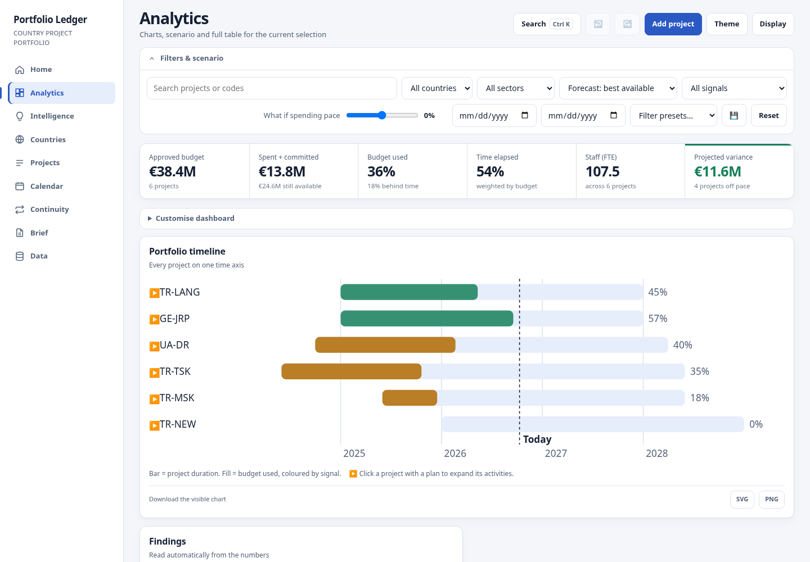
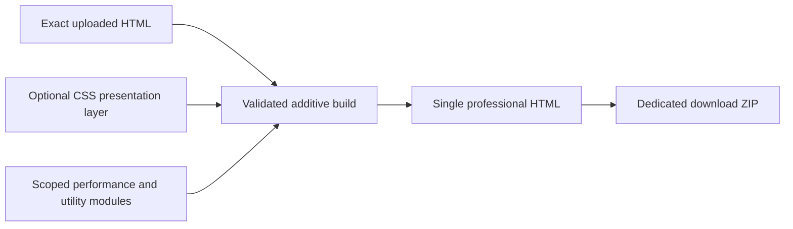

# Professional extensions for the uploaded Ledger 40

This deliverable starts from the user's **portfolio-ledger (40).html**, not the
previous six-workspace redesign. Open **portfolio-ledger-professional.html**.
The separate downloadable ZIP contains only this HTML and a short Turkish readme.
The repository's previous `index.html` is a different version.



## Boundary

`src/original/portfolio-ledger-40.html` is the exact uploaded file, SHA256
`af4f7a60b46f6b092bd7c84abd4f95e83ca81d041dabc92366f823c3cf2fc45e`.
It remains unedited, including the original document readers, storage keys,
navigation, route definitions, grids, SVG generators and financial formulas.

The builder inserts one CSS block before the original head closes and one
JavaScript block inside the original closure immediately before startup. It
asserts the baseline checksum, validates the startup boundary, and verifies that
removing those two blocks restores the baseline byte for byte. It does not
replace the original render function or rewrite source fragments.



## Extensions

| Module            | Behavior                                                                                                              | Boundary                                                                            |
| ----------------- | --------------------------------------------------------------------------------------------------------------------- | ----------------------------------------------------------------------------------- |
| Presentation      | Common type, controls, table spacing, zebra rows, focus, dark theme and mobile filter scrolling                       | Existing menu, screen and section order remain                                      |
| Performance       | 120ms search batching, 64ms scenario batching and per-route source/model memoization                                  | Original computations are called; no cache survives a synchronous view evaluation   |
| Tables            | Search within eligible read-only tables, matching counts, visible-row CSV and keyboard activation of original sorting | Original totals, records and exports remain; interactive/merged tables are excluded |
| Charts            | SVG and 1800px PNG download of existing graphics, with resolved theme colors and description metadata                 | Original chart data, marks and click handlers remain                                |
| Preferences       | Display dialog with individual switches, table density, text size and quiet/original effects                          | Additive `ledger.professional.v1`; original portfolio/IndexedDB stores remain       |
| Undo/redo adapter | Connects the existing header buttons to their closure-local functions and updates disabled states                     | Reuses original history and save operations                                         |

The view registry has small runtime wrappers that delegate to the original
functions while opening/closing a per-evaluation cache. `model`, `finAt` and
`reportRate` delegate through scoped memoization wrappers. `render()` and its
existing listeners remain original. A mutation observer attaches utilities to
newly rendered elements without rebuilding their host tables/charts. Quiet
effects retain final KPI values instead of starting numeral animation frames.

All presentation/tools switches are available from **Display**. Table filtering
is a local viewing operation; portfolio totals remain labelled as unchanged.
Original printing includes those rows even if the local table search hides them.
Visible-row CSV exports displayed text, rather than pretending to be a typed
financial workbook. Formula-like cell prefixes are escaped.

## Build and checks

```sh
python3 scripts/build-professional.py
node --check enhancements/professional.js
node tests/professional.cjs
```

The Python builder uses only the standard library and emits a reproducible ZIP.
The browser suite uses the cloud-provided Playwright and Chromium, temporary
servers/profiles, deterministic demo fixtures and a test-only probe. It checks
the before/after content and structure of 21 routes at desktop/phone widths,
twelve financial scenarios/methods, real CSV/SVG/PNG downloads, persistent
preferences, original forms/undo/redo/JSON import-export and 50/200/1000-project
fixtures. Set `LEDGER_PROFESSIONAL_TEST_PORT` to override default port 8796.
Set `LEDGER_PREVIEWS=1` to regenerate the screenshots in `docs/professional/`.

Performance evidence is written to `test-results/preserve/performance.json`.
Timings are medians of seven Analytics HTML evaluations; they exclude DOM/layout
and document parsing. The original and enhanced Analytics HTML outputs must
match byte for byte on all scale fixtures. Source-comparison calls fall by one
third; elapsed improvements are workload-dependent, so this is not a claim of
uniform application-wide speedup.

The cloud browser blocks `file://` navigation by administrator policy. The suite
therefore supplies the exact distributable HTML through a browser-only route and
verifies that it boots in dark mode on a phone without requesting another asset.
That check verifies self-containment; it does not claim a real `file://` run in
this managed browser. Original parser behavior and financial interpretation are
retained rather than exhaustively revalidated or corrected by a styling extension.

Verified on 10 October 2026: all 10 check groups passed, including 42 before/after
route comparisons. Another 36 light/dark render checks covered 320px, 768px and
1440px widths on six representative screens. Build repeatability, ZIP contents,
JavaScript syntax and Git whitespace checks also passed.

| Projects | Original HTML evaluation | Enhanced HTML evaluation | Source calculations before → after |
| ---: | ---: | ---: | ---: |
| 50 | 4 ms | 3 ms | 126 → 84 |
| 200 | 12 ms | 13 ms | 501 → 334 |
| 1,000 | 53 ms | 43 ms | 2,499 → 1,666 |

These are medians from the latest run using the method above. The 200-project
case illustrates why fewer calculations are not a guaranteed elapsed-time
improvement. Eight rapid search events were separately verified to produce one
final render, compared with immediate rendering when the speed module is off.

## Future changes

New utilities should stay inside the extension layer and delegate to existing
host workflows. Measure a real bottleneck before adding another cache, changing
render scheduling or introducing a dependency. A framework port, new navigation,
reorganized pages, new schema or changes to financial meaning require a separate
scope; they are outside this structure-preserving version.

External design connectors are separate from these application modules. No Figma
file or account connection is required for the build or for its browser checks.
