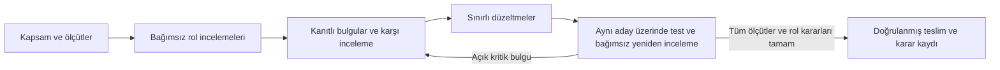

# Dağıtık ürün geliştirme ve onay protokolü

Bu sorgu, mevcut Portfolio Ledger 40 sürümü için kullanıcı tarafından istenen
çalışma düzenidir. Roller bağımsız ajan incelemeleri yapar; karar kaydı gerçek
insanların veya bir kurumun onayı olarak sunulmaz.

## Tekrar kullanılabilir sorgu

> Bu ürünü yedi ayrı uzman rolüyle geliştir ve değerlendir: genel müdür/director,
> proje yöneticisi, kod mimarı, UX/UI direktörü, ürün değerlendirme uzmanı,
> bağımsız denetçi ve deneyimli son kullanıcı. Roller kendi alanlarında titiz
> inceleme yapsın, diğer rollerin bulgularını kanıtlarla sorgulayabilsin.
>
> Önce kullanıcının hedeflerini, korunan sınırları ve kabul ölçütlerini yaz.
> Mevcut menüleri, sayfa/bölüm sırasını, veri yapısını ve hesaplama formüllerini
> koru. Gönderilen orijinal dosyayı değiştirme; iyileştirmeleri ayrı ek katmanlara
> uygula. Eksik bilgi ve ölçülmemiş sonuçları varsayım veya sınır olarak belirt.
>
> İlk incelemeleri birbirinden bağımsız yaptır. Her bulguya kimlik, önem derecesi,
> gözlenebilir kanıt, yeniden üretme adımı, sınırlı düzeltme ve doğrulama koşulu
> ekle. Roller önce kendi görüşlerini kaydetsin, ardından karşılıklı itiraz ve
> uzlaşma yapılabilsin. Kararlar tek bir koordinatörün kanaatine indirgenmesin.
>
> Düzeltmelerden sonra, aynı aday dosyanın içerik hash'i üzerinde bağımsız yeniden
> inceleme yap. Düzeltmeyi yapan kişi/ajan kendi değişikliğinin tek onaylayıcısı
> olmasın. Denetçi finansal/veri doğruluğu ve kaynak sınırlarında; kod mimarı
> teknik doğrulukta; UX/UI direktörü ve kullanıcı kullanılabilirlikte veto hakkına
> sahip olsun. Koordinatör bu vetoları tek taraflı geçersiz kılamasın.
>
> Bloklayıcı veya yüksek önem taşıyan açık sorun kaldıkça düzeltme ve kontrol
> döngüsünü sürdür. Orta önem taşıyan sorunlar düzeltildiği veya ilgili inceleyen
> tarafından gerekçeli, kapsamı belirli bir koşulla kabul edildiği zaman geçsin.
> Test geçişi ile ürün onayını ayrı kaydet; çalıştırılmamış kontrolü geçmiş sayma.
>
> Tamamlanma, tüm kabul ölçütlerinin geçmesi ve yedi rolün kendi kararını vermesi
> olsun. Kanıtsız 'mükemmel' puanı üretme. Yeni kapsam veya salt öznel tercihler
> ortaya çıkınca bunları sonraki iş listesine al; bitmiş işi sonsuz bir döngüye
> dönüştürme. Sonuçta doğrulanmış sürümü, inceleme kararlarını, çözülen/açık
> bulguları ve anlamlı sınırları paylaş.

## Rol yetkileri ve kabul ölçütleri

| Rol | Bağımsız sorumluluk | Onay için gereken kanıt |
| --- | --- | --- |
| Genel müdür / director | Kullanıcı amacı, kapsam ve ürünün bütünü | Kullanıcı sınırlarının korunması, diğer kararların açıkça kaydı |
| Proje yöneticisi | Öncelik, kapsam, teslim ve sürüm açıklığı | Her bulgunun sorumlusu/sonucu; hangi HTML'nin açılacağının açık olması |
| Kod mimarı | Önbellek, olaylar, kaynak yaşam döngüsü, bakım | Parametre değişimlerinde doğru sonuç; düzeltmelerin teknik doğrulaması |
| UX/UI direktörü | Hiyerarşi, okunabilirlik, mobil ve klavye akışı | Mevcut ekranların kullanılabilirliği; gerçek boyutlarda görsel kontrol |
| Ürün değerlendirme uzmanı | Görev sonuçları, kapsam ve etiketlerin anlamı | Arama/sıralama/dışa aktarma davranışının kullanıcı beklentisiyle uyumu |
| Bağımsız denetçi | Kaynak bütünlüğü, finansal eşitlik ve iddialar | Orijinal hash, doğru karşılaştırmalar, gerçek dosya çıktıları ve test kayıtları |
| Deneyimli son kullanıcı | Gerçek görevlerin tamamlanabilirliği | Proje bulma, inceleme, filtreleme, indirme ve ayarların kullanım denemeleri |

## İnceleme döngüsü

Bu protokolün mevcut ürün üzerindeki gerçek sonuçları ayrı bir inceleme kaydında
tutulur. Rol adlarının listelenmesi, inceleme yapıldığı veya onay verildiği
anlamına gelmez.
