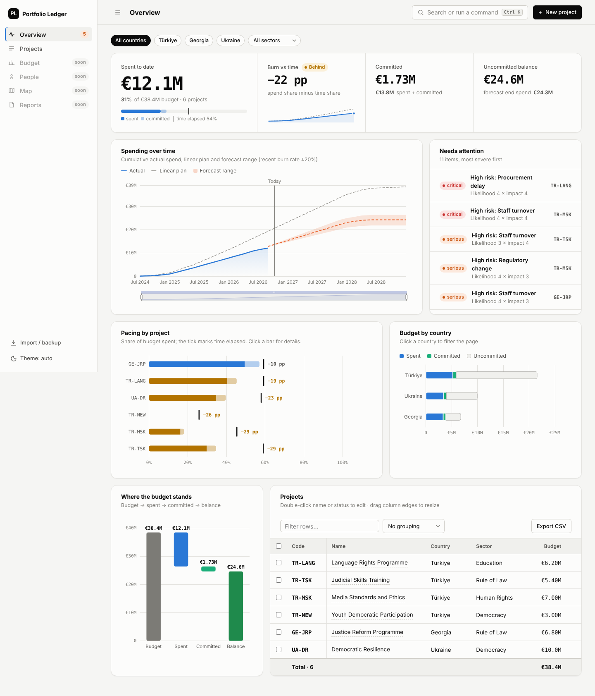
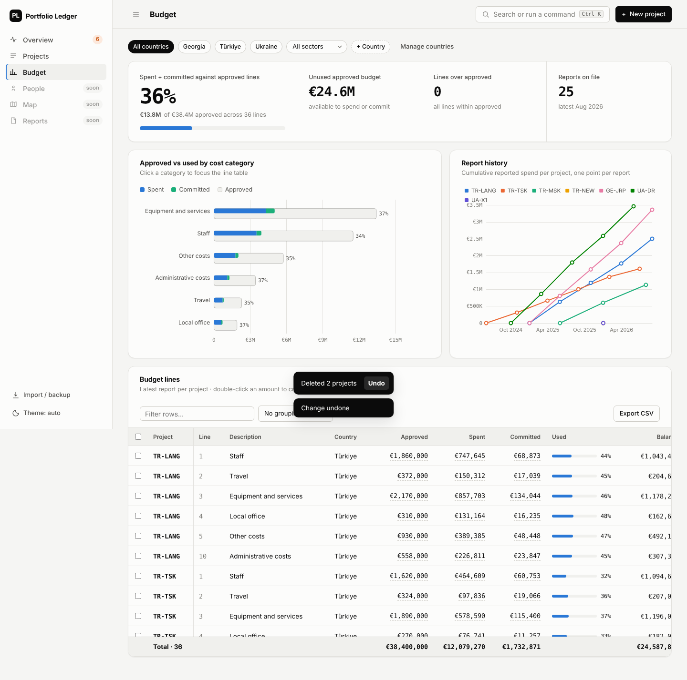
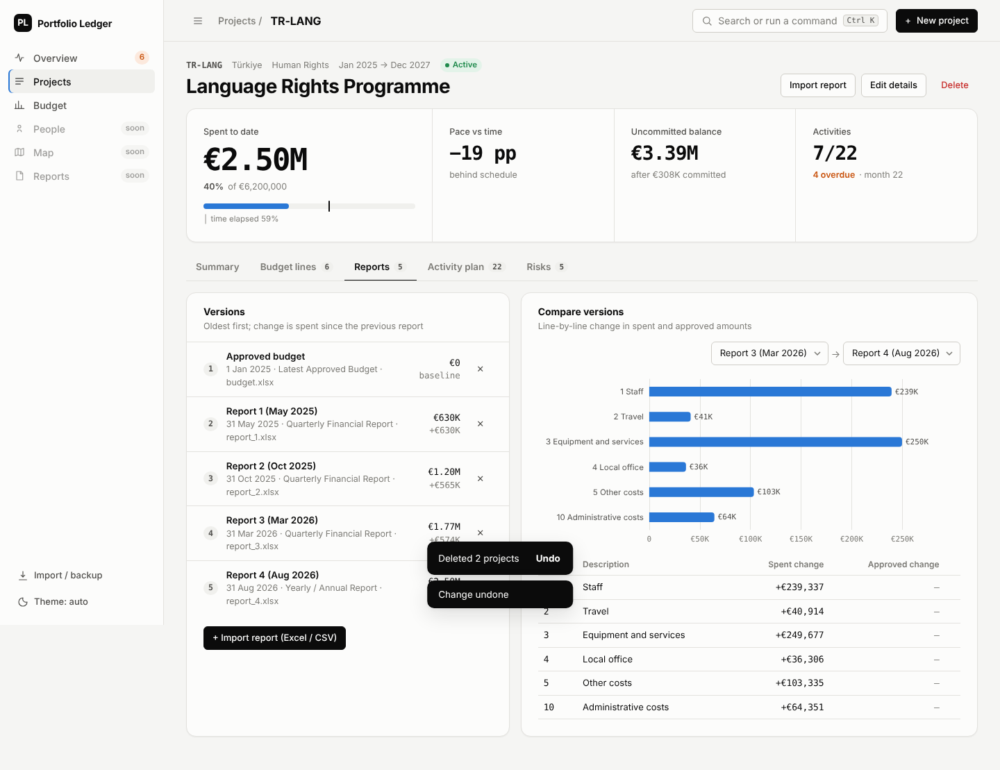
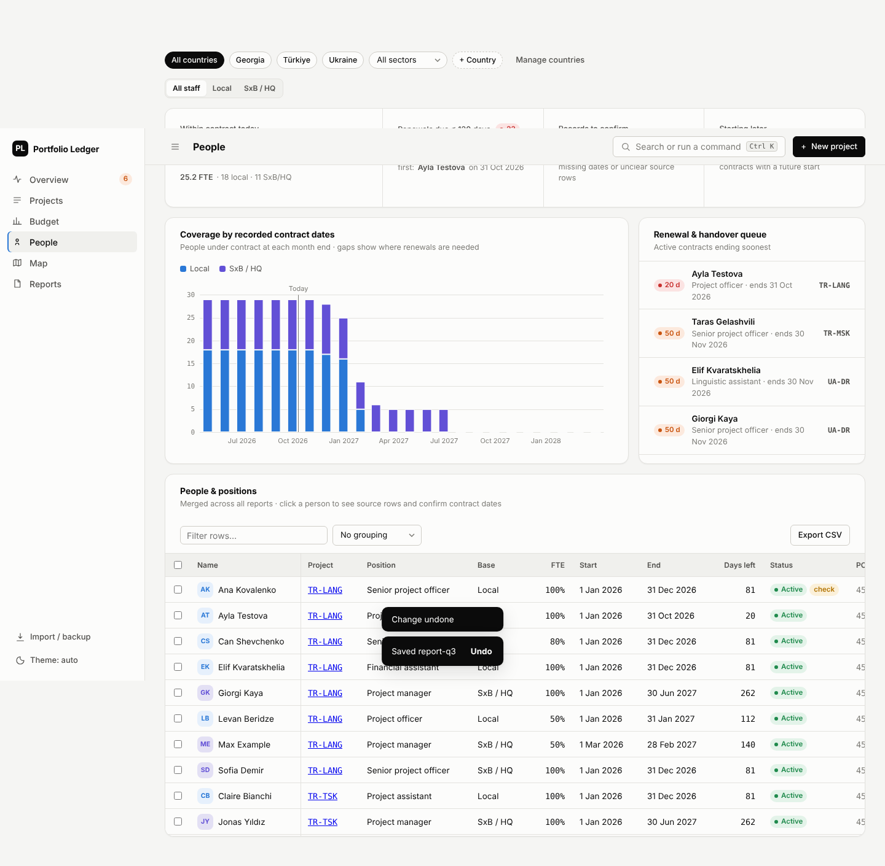
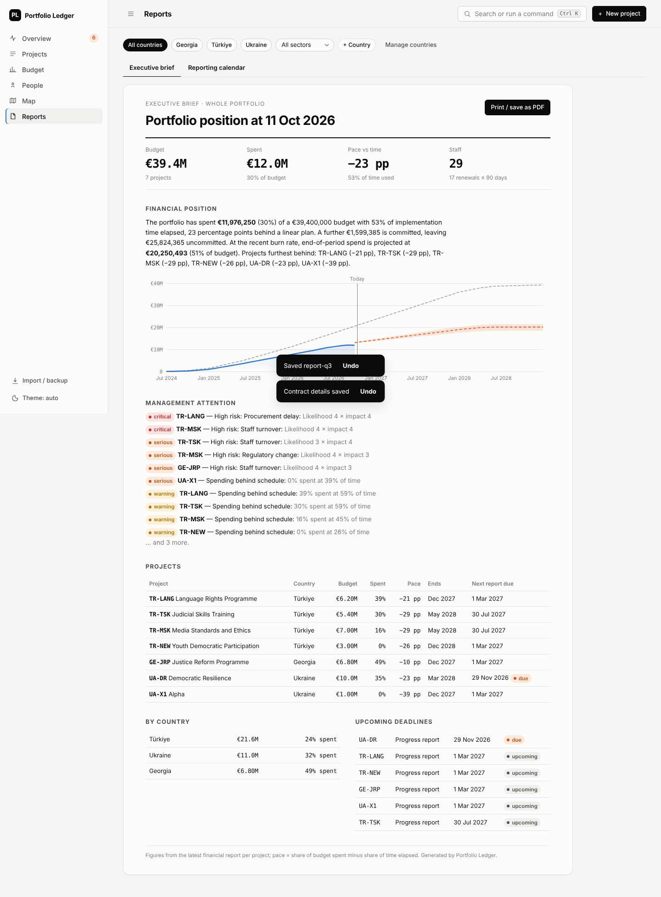

# Portfolio Ledger — Next

Ground-up rebuild of the portfolio ledger. Phase 1: foundations, design system,
Overview, Projects, and the shared chart / table / data-entry components.

**Use it:** open [`../portfolio-ledger-next.html`](../portfolio-ledger-next.html) in a browser.
It is one self-contained offline file; data is kept in the browser (IndexedDB) and can be
exported/imported as a JSON backup (same `{countries, projects}` shape as the earlier ledger).



## What's in phase 1
- **Layout:** one fixed sidebar and one sticky top bar. Nothing else sticks, so content does not shift while scrolling (checked by an automated test).
- **Design system:** all colours, spacing and type sizes live in `src/styles/tokens.css`. Numbers use tabular monospace digits. Light and dark themes, both tuned separately.
- **Overview:** a hero KPI band (spent, pace against time, committed, balance), spending over time with plan line, forecast range and zoom, a ranked attention list, pacing by project, budget by country (click a bar to filter), a budget waterfall, and the project table.
- **Table:** virtual scrolling, sort, filter, column resize (remembered), pinned code column, grouping with subtotals, total row, selection, inline edit (double-click), CSV export.
- **Data entry:** a right-hand drawer instead of in-page forms, with field validation and duplicate-code checks. Ctrl+K command palette. CSV import with automatic column matching, row-by-row preview of problems, and EU/US number and date formats. Every change can be undone (toast or Ctrl+Z).

## Phase 2
- **Fixed sectors:** Human Rights, Democracy, Rule of Law (form dropdown; imports map variants and reject others).
- **Countries:** add / edit / remove from the filter bar ("+ Country", "Manage countries") or Ctrl+K. A country with projects cannot be removed.
- **Master list identifiers:** PMM number, budget head (BH), MAE/division and PMM link on every project (form, project header "PMM ↗" button, table column, search). Importing the master list (Excel/CSV) matches projects by code and updates them instead of creating duplicates; columns missing from the file keep their current values.
- **Projects:** add from the top bar, a country row, or Ctrl+K; delete from the project page, the drawer, or several at once from the table selection. All undoable.
- **Budget workspace:** approved vs used by cost category (click to focus), report history per project, every budget line in one table with inline correction.
- **Project page** (`#/project/<id>`): Summary, Budget lines, Reports (versions + line-by-line comparison), Activity plan (Gantt: preparation / implementation / extension, overdue flags), Risks (5×5 matrix + editable register).
- **Excel import:** `.xlsx` reports and project lists, read in the browser with no extra library. Detects the sheet and header row, skips total rows, maps columns, and checks the report against the previous one (falling cumulative actuals, duplicate codes, lines over approved, budget mismatch).




## Develop
```sh
npm install
npm run dev     # local dev server
npm test        # unit tests (calculations, CSV parsing)
npm run build   # → dist/index.html (single file)
npm run e2e     # browser tests + screenshots (needs Chromium; CHROMIUM=/path)
```

`src/domain/calc.ts` holds every financial calculation and has no UI code; `src/domain/calc.test.ts` reconciles it against the sample data.

## Phase 3
- **People** (also a tab on every project): staff are read from report workbooks — the "Purchase Orders" sheet (reporting lines 1.x.1.y, "Surname, Given - … from dd/mm/yyyy to dd/mm/yyyy … %") plus GL payroll rows — and classified Local or SxB/HQ from the sheet's group headings. Records are merged per person across reports. Shows coverage by month, a renewal queue, rows that need confirming, and a contract panel with the source rows where dates can be confirmed or a leave date set (manual details win over the source).
- **Map:** offline bubble map (size = budget, colour = pace) with country cards, sector mix and alerts; click opens that country's overview.
- **Reports:** a printable executive brief (A4 / save as PDF) with a written financial summary, and a reporting calendar of contractual progress and final report deadlines (overdue / due / upcoming / submitted).

The sample data includes fictional demo staff so the People screens can be seen.




## Possible next steps
 People / contracts, Map, Reports & logframe, visual regression baselines.
